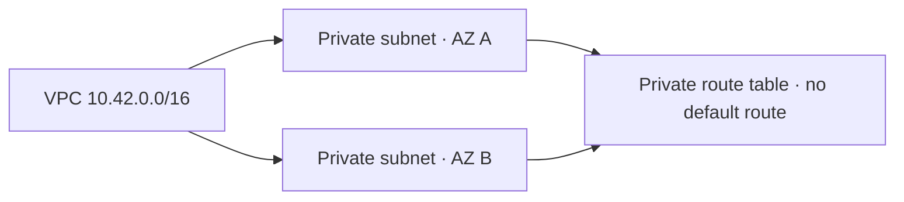

# AWS Secure Platform Baseline

A portfolio lab for designing a small, private AWS network foundation with Terraform. It focuses on repeatable infrastructure, least exposure by default, and a plan-first workflow.

## What this demonstrates

- Terraform provider and version constraints
- A DNS-enabled VPC with private subnets across configurable Availability Zones
- Route tables without an internet gateway or NAT gateway
- Tagging and outputs that make the foundation composable
- Credential-free CI checks for formatting and static configuration validation

## Architecture



## Repository layout

- `versions.tf`, `providers.tf`: Terraform and AWS provider constraints
- `variables.tf`: region, naming, CIDR, environment, and AZ inputs
- `network.tf`: VPC, private subnets, and route table associations
- `outputs.tf`: IDs for a later EKS or application layer
- `.github/workflows/terraform.yml`: format and validate on pull requests

## Prerequisites

- Terraform 1.7+
- AWS CLI credentials configured locally for the account you intend to use
- An AWS account if you choose to apply the configuration

## Try it safely

```sh
cp terraform.tfvars.example terraform.tfvars
terraform init
terraform fmt -check -recursive
terraform validate
terraform plan
```

The repository does not apply infrastructure and contains no cloud credentials. A plan is read-only, but it still requires AWS credentials and can query the selected account. Review the plan before any apply. The default configuration creates only network resources if applied; keep workloads, public routes, NAT gateways, and remote state as explicit follow-up decisions.

## Security and design notes

- Subnets do not assign public IPs.
- There is no internet gateway, NAT gateway, route to the internet, or workload.
- State is local for this learning example. Do not put production state in Git; use an encrypted, access-controlled remote backend with locking for real deployments.
- Never commit `terraform.tfvars`, state files, credentials, or private keys.

## Next steps

Add a separately reviewed EKS layer, VPC endpoints, cross-account role assumptions, and cost-aware environment examples. Keep those layers optional and document their operational and cost impact.

## License

MIT. See [LICENSE](LICENSE).
